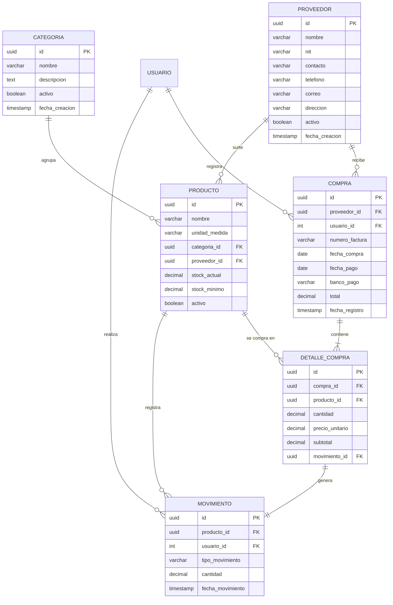

# Modelo de Datos

## Descripción General

El sistema de gestión de inventario permite administrar productos, organizarlos por categorías, asociarlos a sus proveedores, registrar las compras realizadas a cada proveedor y llevar los movimientos de entrada y salida realizados por los usuarios autorizados.

---

## Usuario

### Descripción

Representa al administrador o usuario autorizado que realiza operaciones dentro del sistema.

| Campo | Tipo |
|---------|---------|
| id | UUID |
| nombre | VARCHAR |
| correo | VARCHAR |
| password | VARCHAR |
| fecha_creacion | TIMESTAMP |

---

## Categoría

### Descripción

Agrupa los productos según su tipo (ej: granos, frutas y verduras, lácteos). Permite organizar el catálogo y facilitar consultas y análisis por categoría.

| Campo | Tipo | Restricciones |
|---------|---------|---------|
| id | UUID | PK |
| nombre | VARCHAR(80) | Obligatorio. Único (sin distinguir mayúsculas) entre categorías activas |
| descripcion | TEXT | Opcional |
| activo | BOOLEAN | Por defecto `true` (borrado lógico) |
| fecha_creacion | TIMESTAMP | Automático |

---

## Proveedor

### Descripción

Representa a la persona o empresa que surte productos al mini mercado.

| Campo | Tipo | Restricciones |
|---------|---------|---------|
| id | UUID | PK |
| nombre | VARCHAR(150) | Obligatorio (nombre o razón social). Único entre proveedores activos |
| nit | VARCHAR(20) | Opcional. Si se registra, único entre proveedores activos |
| contacto | VARCHAR(100) | Opcional (persona de contacto) |
| telefono | VARCHAR(20) | Opcional |
| correo | VARCHAR(254) | Opcional, formato de correo válido |
| direccion | VARCHAR(200) | Opcional |
| activo | BOOLEAN | Por defecto `true` (borrado lógico) |
| fecha_creacion | TIMESTAMP | Automático |

---

## Producto

### Descripción

Representa un producto almacenado dentro del inventario.

| Campo | Tipo |
|---------|---------|
| id | UUID |
| nombre | VARCHAR |
| descripcion | TEXT |
| unidad_medida | VARCHAR |
| categoria_id | UUID (FK → Categoría, **obligatoria**) |
| proveedor_id | UUID (FK → Proveedor, opcional) |
| stock_actual | DECIMAL |
| stock_minimo | DECIMAL |
| activo | BOOLEAN |
| fecha_creacion | TIMESTAMP |

---

## Compra

### Descripción

Representa una compra realizada a un proveedor. Al registrarse genera automáticamente una ENTRADA de inventario por cada producto comprado. Es inmutable: no se edita ni se elimina, para conservar la trazabilidad.

| Campo | Tipo | Restricciones |
|---------|---------|---------|
| id | UUID | PK |
| proveedor_id | UUID | FK → Proveedor (PROTECT). Obligatorio, debe estar activo |
| usuario_id | INT | FK → Usuario que la registró (PROTECT) |
| numero_factura | VARCHAR(50) | Opcional. Única por proveedor cuando se registra |
| fecha_compra | DATE | Obligatoria (por defecto hoy). No puede ser futura |
| fecha_pago | DATE | Opcional |
| banco_pago | VARCHAR(80) | Opcional |
| observacion | TEXT | Opcional |
| total | DECIMAL(14,2) | Suma de subtotales del detalle. `CHECK total >= 0` |
| fecha_registro | TIMESTAMP | Automático |

---

## DetalleCompra

### Descripción

Línea de una compra: un producto, la cantidad recibida y su precio unitario. Queda enlazada al movimiento de ENTRADA que generó.

| Campo | Tipo | Restricciones |
|---------|---------|---------|
| id | UUID | PK |
| compra_id | UUID | FK → Compra (CASCADE) |
| producto_id | UUID | FK → Producto (PROTECT). Debe estar activo |
| cantidad | DECIMAL(10,2) | `CHECK cantidad > 0` |
| precio_unitario | DECIMAL(12,2) | `CHECK precio_unitario >= 0` |
| subtotal | DECIMAL(14,2) | cantidad × precio_unitario (redondeado a centavos) |
| movimiento_id | UUID | FK única (1:1) → Movimiento de ENTRADA generado |

Restricción: `UNIQUE (compra_id, producto_id)` — un producto aparece una sola vez por compra.

---

## Movimiento

### Descripción

Representa una entrada o salida de inventario asociada a un producto y registrada por un usuario.

| Campo | Tipo |
|---------|---------|
| id | UUID |
| producto_id | UUID |
| usuario_id | UUID |
| tipo_movimiento | VARCHAR |
| cantidad | DECIMAL |
| observacion | TEXT |
| fecha_movimiento | TIMESTAMP |

---

# Relaciones

Categoría (1) ---- (N) Producto

Proveedor (1) ---- (N) Producto

Producto (1) ---- (N) Movimiento

Proveedor (1) ---- (N) Compra

Compra (1) ---- (N) DetalleCompra

Producto (1) ---- (N) DetalleCompra

DetalleCompra (1) ---- (1) Movimiento

Usuario (1) ---- (N) Movimiento

---

# Reglas de Negocio

- Un producto puede tener múltiples movimientos de inventario.
- Un movimiento debe estar asociado a un único producto.
- Un usuario puede registrar múltiples movimientos.
- Un movimiento debe estar asociado a un único usuario.
- El stock actual del producto debe actualizarse cada vez que se registre un movimiento.
- El sistema debe alertar cuando el stock actual sea menor o igual al stock mínimo definido.
- Un producto pertenece a una sola categoría; una categoría puede agrupar muchos productos.
- Un producto tiene un solo proveedor; un proveedor puede surtir muchos productos.
- La categoría de un producto es **obligatoria**; el proveedor es opcional.
- Los productos registrados antes de que la categoría fuera obligatoria se asignaron automáticamente a la categoría **"General"** (migración `0011_asignar_categoria_general`). Después, la columna `categoria_id` pasó a `NOT NULL` (migración `0012_categoria_obligatoria`).
- Solo se puede asignar a un producto una categoría o un proveedor **activo**.
- Las categorías y los proveedores no se eliminan físicamente: se desactivan (borrado lógico).
- No se puede desactivar una categoría o un proveedor mientras tenga productos activos asociados; primero deben reasignarse.
- A nivel de base de datos las llaves foráneas usan `ON DELETE PROTECT`, por lo que tampoco es posible borrar físicamente una categoría o proveedor con productos.
- Una compra pertenece a un único proveedor activo y debe tener al menos un producto.
- Al registrar una compra, cada producto del detalle genera una ENTRADA que aumenta su stock. La compra, su detalle y las entradas se guardan en una sola transacción: si algo falla, no se guarda nada.
- Un proveedor no puede tener dos compras con el mismo número de factura.
- Las compras son inmutables (no se editan ni se eliminan), igual que los movimientos.

---

# Diagrama entidad-relación

---

# Endpoints de la API

| Recurso | Ruta | Operaciones | Filtros |
|---------|---------|---------|---------|
| Categorías | `/api/categorias/` | Listar, crear, ver, editar (PATCH/PUT), desactivar (DELETE) | `?q=` nombre |
| Proveedores | `/api/proveedores/` | Listar, crear, ver, editar (PATCH/PUT), desactivar (DELETE) | `?q=` nombre, NIT o contacto |
| Productos | `/api/productos/` | Listar, crear, ver, editar, desactivar | `?q=`, `?categoria=<id>`, `?proveedor=<id>` |
| Compras | `/api/compras/` | Listar, ver, registrar (no se editan ni eliminan) | `?q=` factura o proveedor, `?proveedor=<id>`, `?desde=`, `?hasta=` (AAAA-MM-DD) |

Para registrar una compra se envía `proveedor`, los datos opcionales de factura y `detalles: [{producto, cantidad, precio_unitario}]`. Cada movimiento devuelve `compra` con el id de la compra que lo generó (o `null`).

Categorías y proveedores devuelven además `total_productos` (productos activos asociados). Los productos devuelven `categoria`, `categoria_nombre`, `proveedor` y `proveedor_nombre`.