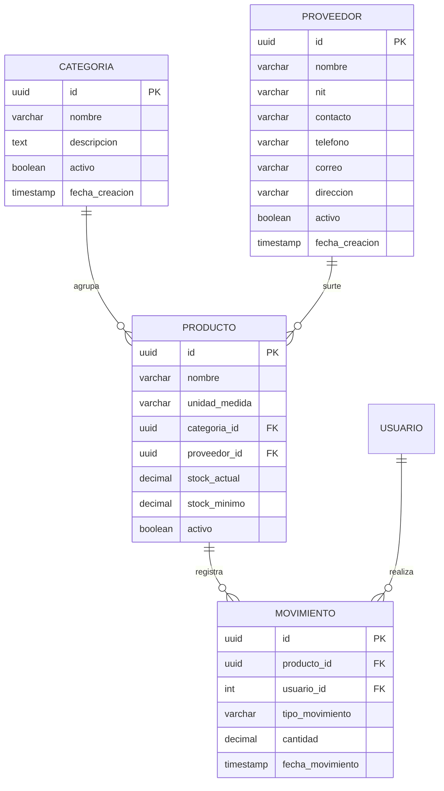

# Modelo de Datos

## Descripción General

El sistema de gestión de inventario permite administrar productos, organizarlos por categorías, asociarlos a sus proveedores y registrar los movimientos de entrada y salida realizados por los usuarios autorizados.

---

## Usuario

### Descripción

Representa al administrador o usuario autorizado que realiza operaciones dentro del sistema.

| Campo | Tipo |
|---------|---------|
| id | UUID |
| nombre | VARCHAR |
| correo | VARCHAR |
| password | VARCHAR |
| fecha_creacion | TIMESTAMP |

---

## Categoría

### Descripción

Agrupa los productos según su tipo (ej: granos, frutas y verduras, lácteos). Permite organizar el catálogo y facilitar consultas y análisis por categoría.

| Campo | Tipo | Restricciones |
|---------|---------|---------|
| id | UUID | PK |
| nombre | VARCHAR(80) | Obligatorio. Único (sin distinguir mayúsculas) entre categorías activas |
| descripcion | TEXT | Opcional |
| activo | BOOLEAN | Por defecto `true` (borrado lógico) |
| fecha_creacion | TIMESTAMP | Automático |

---

## Proveedor

### Descripción

Representa a la persona o empresa que surte productos al mini mercado.

| Campo | Tipo | Restricciones |
|---------|---------|---------|
| id | UUID | PK |
| nombre | VARCHAR(150) | Obligatorio (nombre o razón social). Único entre proveedores activos |
| nit | VARCHAR(20) | Opcional. Si se registra, único entre proveedores activos |
| contacto | VARCHAR(100) | Opcional (persona de contacto) |
| telefono | VARCHAR(20) | Opcional |
| correo | VARCHAR(254) | Opcional, formato de correo válido |
| direccion | VARCHAR(200) | Opcional |
| activo | BOOLEAN | Por defecto `true` (borrado lógico) |
| fecha_creacion | TIMESTAMP | Automático |

---

## Producto

### Descripción

Representa un producto almacenado dentro del inventario.

| Campo | Tipo |
|---------|---------|
| id | UUID |
| nombre | VARCHAR |
| descripcion | TEXT |
| unidad_medida | VARCHAR |
| categoria_id | UUID (FK → Categoría, opcional) |
| proveedor_id | UUID (FK → Proveedor, opcional) |
| stock_actual | DECIMAL |
| stock_minimo | DECIMAL |
| activo | BOOLEAN |
| fecha_creacion | TIMESTAMP |

---

## Movimiento

### Descripción

Representa una entrada o salida de inventario asociada a un producto y registrada por un usuario.

| Campo | Tipo |
|---------|---------|
| id | UUID |
| producto_id | UUID |
| usuario_id | UUID |
| tipo_movimiento | VARCHAR |
| cantidad | DECIMAL |
| observacion | TEXT |
| fecha_movimiento | TIMESTAMP |

---

# Relaciones

Categoría (1) ---- (N) Producto

Proveedor (1) ---- (N) Producto

Producto (1) ---- (N) Movimiento

Usuario (1) ---- (N) Movimiento

---

# Reglas de Negocio

- Un producto puede tener múltiples movimientos de inventario.
- Un movimiento debe estar asociado a un único producto.
- Un usuario puede registrar múltiples movimientos.
- Un movimiento debe estar asociado a un único usuario.
- El stock actual del producto debe actualizarse cada vez que se registre un movimiento.
- El sistema debe alertar cuando el stock actual sea menor o igual al stock mínimo definido.
- Un producto pertenece a una sola categoría; una categoría puede agrupar muchos productos.
- Un producto tiene un solo proveedor; un proveedor puede surtir muchos productos.
- La categoría y el proveedor de un producto son opcionales, para conservar los productos registrados antes de estos módulos.
- Solo se puede asignar a un producto una categoría o un proveedor **activo**.
- Las categorías y los proveedores no se eliminan físicamente: se desactivan (borrado lógico).
- No se puede desactivar una categoría o un proveedor mientras tenga productos activos asociados; primero deben reasignarse.
- A nivel de base de datos las llaves foráneas usan `ON DELETE PROTECT`, por lo que tampoco es posible borrar físicamente una categoría o proveedor con productos.

---

# Diagrama entidad-relación

---

# Endpoints de la API

| Recurso | Ruta | Operaciones | Filtros |
|---------|---------|---------|---------|
| Categorías | `/api/categorias/` | Listar, crear, ver, editar (PATCH/PUT), desactivar (DELETE) | `?q=` nombre |
| Proveedores | `/api/proveedores/` | Listar, crear, ver, editar (PATCH/PUT), desactivar (DELETE) | `?q=` nombre, NIT o contacto |
| Productos | `/api/productos/` | Listar, crear, ver, editar, desactivar | `?q=`, `?categoria=<id>`, `?proveedor=<id>` |

Categorías y proveedores devuelven además `total_productos` (productos activos asociados). Los productos devuelven `categoria`, `categoria_nombre`, `proveedor` y `proveedor_nombre`.